---

## 🧑‍💻 About me

- 📱 **5+ years** shipping native and cross-platform apps on Android, iOS and the web
- 🎙️ Currently building **Motorola's Audio Recorder** app (Instituto Eldorado)
- 💳 Previously worked on **Samsung Wallet** (SiDi), **Localiza** (iOS) and **Méliuz** (React Native)
- 🔐 Deep interest in **mobile security**: RASP, anti-tampering, obfuscation and hardware-backed crypto
- 🚀 Built **Alting Social** from zero to production on iOS, Android and Web as a side project
- 🎓 B.Sc. in Computer Science · Postgraduate studies in High-Performance Computing

---

## ⭐ Featured open source

<table>
<tr>
<td width="50%" valign="top">

### 🛡️ [MaigShield](https://github.com/Maignardi/MaigShield)

Android **RASP & anti-fraud SDK** for banking and fintech apps.

- Zero-boolean design: the device never decides, the backend does
- 76-byte telemetry proof, RSA-OAEP + AES-256-GCM, signed with a **StrongBox/TEE** key
- Native **C++20** core with direct syscalls: Frida, Xposed, Magisk, root and hook detection
- Banking-trojan defenses: accessibility abuse, screen mirroring, tapjacking
- Behavioral biometrics (bot and duress scores)

</td>
<td width="50%" valign="top">

### 🔒 [MaigVeil](https://github.com/Maignardi/MaigVeil)

Android **binary hardening suite** that goes beyond R8/ProGuard.

- Gradle plugin with a multi-pass **ASM 9** bytecode transformer
- Per-build polymorphic string encryption and control-flow flattening
- Sensitive calls hidden behind `INVOKEDYNAMIC`
- Custom **C++20 bytecode VM** with per-build shuffled opcodes
- ChaCha20-Poly1305 asset vault and silent anti-repackaging

</td>
</tr>
<tr>
<td colspan="2" valign="top">

### 🔐 [MaigSecurityCrypto](https://github.com/Maignardi/MaigSecurityCrypto)

**Kotlin Multiplatform** replacement for the deprecated `EncryptedSharedPreferences` and `EncryptedFile` (Android, iOS and JVM).

- Envelope encryption: **AndroidKeyStore / StrongBox** master key wrapping a **Google Tink** keyset, iOS Keychain on Apple platforms
- Authenticated binary format that blocks file swapping, truncation and algorithm downgrade attacks
- Reactive, type-safe preferences and `@Serializable` object stores built on **Jetpack DataStore**
- Automatic key rotation, biometric binding, secure wipe and migration from legacy `SharedPreferences`
- Nothing leaks to cloud backups by default

</td>
</tr>
</table>

---

## 📲 More projects

| Project | What it is | Stack |
|---|---|---|
| [**KMP To-Do List**](https://github.com/Maignardi/KMP_TO_DO_LIST) | Kotlin Multiplatform app sharing UI between Android and iOS | Kotlin · Compose Multiplatform |
| [**Recorder**](https://github.com/Maignardi/Recorder) | Voice recorder with **AI transcription and summaries** (Whisper + Llama via Groq), waveform, trimming and folders | Kotlin · Clean Architecture · Hilt · Room |
| [**NFC Reader**](https://github.com/Maignardi/NFC-READER) | Reads and parses NFC tags on Android | Kotlin · NFC |
| [**Apple Watch Work Timer**](https://github.com/Maignardi/AppleWatchWorkTimer) | Apple Watch app that tells you when your workday ends | Swift · SwiftUI · watchOS |
| [**Watch ↔ Mobile Stopwatch**](https://github.com/Maignardi/stopwatch_watch_connection_to_mobile) | Wear OS stopwatch synced with the phone via the Wearable Data Layer | Kotlin · Compose for Wear OS |
| [**Movies Streaming**](https://github.com/Maignardi/moviesStreaming) | Movie catalog and streaming UI | Kotlin · Jetpack Compose |

---

## 🛠️ Tech stack

**Android**

**iOS**

**Cross-platform & web**

**Native, security & backend**

---

💬 **Open to talking about mobile, security and new opportunities.** Reach me on [LinkedIn](https://www.linkedin.com/in/matheus-maignardi/).

